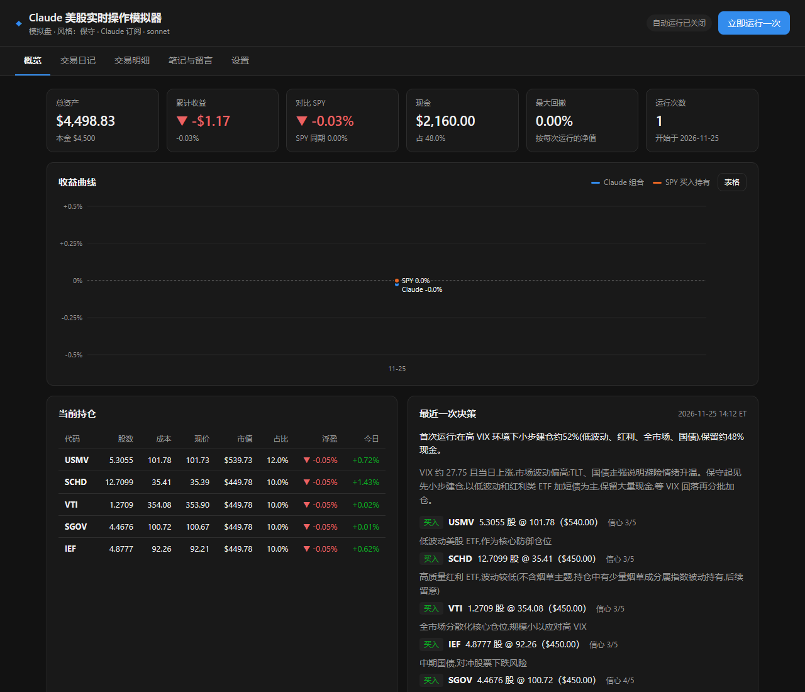

# Claude 美股实时操作模拟器 · Claude US Stock Live Trading Simulator

[中文](#中文) · [English](#english)

> ⚠️ **这是模拟盘（paper trading），不连接券商，不动真钱，也不构成任何投资建议。**
> **This is paper trading only. It never touches a brokerage or real money, and nothing here is investment advice.**



---

## 中文

### 这是什么

给 Claude 一笔虚拟本金，让它在美股开盘时间里，每隔几个小时看一次行情和新闻，然后按你选的风格自己决定买什么、卖什么。所有决策、理由、成交、持仓和收益都记录下来，并且和 SPY（或你指定的基准）对比。

- **网页面板**：看收益曲线、持仓、每一次决策的理由，修改所有设置，给 Claude 留言。
- **三种预设风格 + 自定义**：激进、保守、长期稳健，或者用你自己的话描述风格。
- **两种调用方式**：用你的 Claude 订阅（Pro / Max 等包含 Claude Code 的套餐，不另外花钱），或者用 API key 按量付费。
- **频率可调**：开盘时间内每 0.5 到 6.5 小时检查一次，周末和美股节假日自动跳过。
- **Claude 有记忆**：每次运行结束时它会重写一份「策略笔记」，下次运行时再读回来，还可以随时查自己过去的全部交易记录，策略才能前后连贯。
- **几乎零依赖**：网页用 Python 标准库实现，前端是原生 JS，不需要 Node、数据库服务或任何 CDN。行情数据来自 Yahoo Finance。

### 快速开始

**1. 安装**（需要 Python 3.9 或更高版本）

```bash
git clone https://github.com/LunaSakurakouji0327/claude-us-stock-simulator.git
cd claude-us-stock-simulator
pip install -r requirements.txt
```

**2. 二选一：决定怎么调用 Claude**

| 方式 | 适合谁 | 准备工作 |
|---|---|---|
| **Claude 订阅**（默认） | 已经有 Claude Pro / Max 等套餐 | 安装 [Claude Code](https://code.claude.com/docs) 并登录：`npm install -g @anthropic-ai/claude-code`，然后运行一次 `claude` 完成登录 |
| **API key** | 想按量付费，或者没有订阅 | 在 [platform.claude.com](https://platform.claude.com) 创建 API key，设置环境变量 `ANTHROPIC_API_KEY`，或者稍后在网页设置里填写 |

**3. 启动**

```bash
python trader.py start
```

浏览器打开 **http://127.0.0.1:8765** ，进入「设置」页，选好本金、风格、检查频率和调用方式，点「保存设置」。

> 为了不在默认设置上开始交易，**保存过一次设置之后才会开始自动运行**。想马上看效果，可以点右上角「立即运行一次」。

### 设置说明

所有设置都可以在网页「设置」页修改，保存在本机的 `config.json`（已在 `.gitignore` 里，不会被上传）。完整字段见 [`config.example.json`](config.example.json)。

| 设置 | 说明 |
|---|---|
| 本金 | 虚拟起始资金（美元）。已经开始的账户改本金后，需要在设置页底部「重置账户」才生效；旧记录会自动备份，不会删除。 |
| 对比基准 | 默认 SPY，也可以填 QQQ 等。 |
| 炒股风格 | 见下表。另外有一个「补充要求」框：选预设风格时会作为额外要求（比如「不买烟草股」），选「自定义」时就是风格本身。 |
| 单只持仓上限 | 默认跟随风格；由程序强制执行，超过的买单会被自动缩小。 |
| 检查频率 | 每隔几小时检查一次，以及每天第一次检查的美东时间。比如每 2 小时、从 09:45 开始，就是每天 09:45、11:45、13:45、15:45 四次。 |
| 调用方式 / 模型 | 订阅或 API key；模型可选 Opus（最强）、Sonnet（均衡）、Haiku（最省）。 |
| 每次最多搜索 | 每次运行最多搜几次新闻。设成 0 就不上网。 |
| 给 Claude 留言 | 在「笔记与留言」页。留言会附在之后每一次运行里，Claude 会在日记里回复你。 |

**三种预设风格**

| 风格 | 方针 | 单只上限 |
|---|---|---|
| 激进 | 集中持有 3 到 6 只高成长、强势股，追求大幅跑赢大盘，能承受 30% 以上的回撤。 | 40% |
| 保守 | 保本优先，分散持有宽基、红利、低波动和短中期国债 ETF，保留现金缓冲，回撤要小于大盘。 | 15% |
| 长期稳健 | 核心仓位是宽基指数 ETF，少量优质个股作为卫星，分批建仓、低换手，以年为单位思考。 | 60% |
| 自定义 | 完全按你写的描述来。 | 不限 |

风格的完整提示词在 [`claude_trader/styles.py`](claude_trader/styles.py)，可以直接改，也可以加新的风格。

### 额度和费用

我们实测的单次运行（第一次建仓，不同模型）：

| 模型 | 输入 tokens | 输出 tokens | 耗时 |
|---|---|---|---|
| Opus | 约 11 万 | 约 1,800 | 约 50 秒 |
| Sonnet | 约 5 万 | 约 1,400 | 约 25 秒 |

输入里大部分是每次重复的提示和工具说明。如果它多搜几次新闻、多查几只股票，单次用量会更高。

- **订阅模式**：会占用你订阅的用量额度（和你自己用 Claude Code 共用同一份额度）。Anthropic 没有公布每个套餐的具体 token 数，建议先跑一两天，在 Claude Code 里输入 `/usage` 看看实际占了多少；不够用就改成 Sonnet，或者降低检查频率。
- **API 模式**：按 token 计费，价格见 [官方定价](https://www.anthropic.com/pricing)。建议在 Console 里给 key 设置月度预算上限。每次运行的 token 用量都会记在交易日记里。

### 让它一直运行

程序只有在运行时才会交易，电脑睡眠时也会停。两种做法：

**方法 A：一直开着 `start`**（最简单）

```bash
python trader.py start
```

需要关掉电脑的自动睡眠。Windows 可以在「任务计划程序」里建一个「登录时」触发的任务，程序填 `pythonw.exe`，参数填 `trader.py start`，起始位置填项目目录，这样重启后会自动启动，也不会弹黑窗口。macOS 可以用 `caffeinate -i python3 trader.py start` 防止睡眠。

**方法 B：交给系统定时器调用 `tick`**（更省资源，网页需要时再开）

`tick` 每次只检查一下：如果有到点但还没跑的时段就跑一次，否则立刻退出。让系统每 10 分钟调用一次即可：

```bash
# Linux / macOS crontab -e
*/10 * * * 1-5 cd /path/to/claude-us-stock-simulator && /usr/bin/python3 trader.py tick
```

Windows 任务计划程序：触发器选「每天，每 10 分钟重复一次」，操作 `pythonw.exe trader.py tick`，并勾选「唤醒计算机运行此任务」。想看网页时再运行 `python trader.py web`（只开网页，不会重复交易）。

### 命令一览

```
python trader.py start            网页面板 + 自动运行（推荐）
python trader.py web              只开网页面板
python trader.py scheduler        只自动运行，不开网页
python trader.py tick             到点就跑一次（给 cron / 任务计划程序用）
python trader.py once --force     立刻跑一次（--force 表示不管是否开盘）
python trader.py report           在终端里看业绩，并导出 runs.csv / trades.csv
python trader.py reset            备份当前账户，按设置里的本金重新开始

可选参数：--host 0.0.0.0 --port 8765
```

### 记录保存在哪里

所有数据都在 `data/` 目录（不会被上传到 Git）：

| 文件 | 内容 |
|---|---|
| `trader.db` | SQLite 数据库：每次运行（净值、市场判断、总结、token 用量）、每笔交易（含理由和信心）、每次的持仓快照。网页和 Claude 读的都是它。 |
| `state.json` | 当前现金、持仓、Claude 的策略笔记和观察名单。 |
| `journal.md` | 人类可读的交易日记，可以直接用任何 Markdown 编辑器打开。 |
| `errors.log` / `run.log` | 出错记录 / 后台运行输出。 |

**Claude 怎么读自己的记录**：每次运行时，程序会把账户、持仓、大盘行情、策略笔记、最近 8 次运行和最近 15 笔交易一起发给 Claude。需要看更早的记录时，它可以自己调用 `records` 工具查询数据库。

### 工作原理

```
每个时段 ──► 拉取行情（Yahoo Finance）──► 组装提示：账户、持仓、策略笔记、近期记录、你的留言
           ──► Claude 研究（查报价 / K 线 / 历史记录 / 搜新闻）──► 返回结构化决策
           ──► 程序校验并模拟成交（先卖后买、滑点、持仓上限、现金不足时缩小）
           ──► 写入数据库和日记 ──► 网页展示
```

- **规则由程序强制执行**：只做多美股和 ETF，不加杠杆、不做空，不碰期权和加密货币。默认滑点 0.05%、零佣金、允许碎股，都可以改。
- **订阅模式的安全措施**：通过 `claude -p` 调用时，Claude 只被允许使用三个只读的行情 / 记录命令和网页搜索，其他命令和文件编辑一律拒绝。
- **网页只监听本机**（127.0.0.1），并且会拦截跨站请求和 DNS rebinding。如果改成 `--host 0.0.0.0`，同一局域网里的人也能打开并修改设置。

### 项目结构

```
trader.py                 命令行入口
claude_trader/
  config.py               设置：默认值、校验、读写 config.json
  styles.py               炒股风格预设（提示词 + 持仓上限）
  market.py               行情（yfinance）、开盘判断
  portfolio.py            账户状态、SQLite、估值、模拟成交
  brain.py                提示词，以及两种调用方式（claude -p / anthropic SDK）
  engine.py               单次运行、调度、日记
  web.py                  网页后端（标准库 http.server）
  static/                 网页前端（HTML / CSS / 原生 JS）
```

### 常见问题

- **数据准吗？** Yahoo Finance 的价格大约有 1 分钟延迟；模拟成交没有盘口冲击，所以比实盘理想。`yfinance` 是非官方接口，偶尔会挂；挂了会记进 `errors.log` 并跳过那一次，不会让程序崩溃。
- **几周就能看出好坏吗？** 不能。几周的结果多半是运气，至少看几个月，并且要对比基准。
- **能同时跑多个账户吗？** 可以。用环境变量 `CLAUDE_TRADER_HOME` 给每个账户指定不同的数据目录，再用不同的 `--port` 启动。
- **订阅模式报「找不到 claude 命令」？** 确认在终端里能直接运行 `claude`，并且已经登录。

---

## English

### What it is

Give Claude a virtual bankroll. During US market hours it checks prices and news every few hours and decides on its own what to buy and sell, following the investment style you pick. Every decision, reason, fill, position and return is recorded and compared with SPY (or any benchmark you choose).

- **Web dashboard**: equity curve, holdings, the reasoning behind every decision, all settings, and a message box for talking to Claude.
- **Three preset styles + custom**: aggressive, conservative, long-term steady, or describe your own in plain words.
- **Two ways to call Claude**: your Claude subscription (Pro / Max or any plan that includes Claude Code, at no extra cost), or a pay-as-you-go API key.
- **Adjustable frequency**: every 0.5 to 6.5 hours during market hours. Weekends and US market holidays are skipped automatically.
- **Memory across runs**: at the end of every run Claude rewrites a strategy notebook that it reads back next time, and it can query its full trade history, so its strategy stays consistent.
- **Almost no dependencies**: the web server uses the Python standard library and the front-end is plain JS, with no Node, database server or CDN. Market data comes from Yahoo Finance.

### Quick start

**1. Install** (Python 3.9+)

```bash
git clone https://github.com/LunaSakurakouji0327/claude-us-stock-simulator.git
cd claude-us-stock-simulator
pip install -r requirements.txt
```

**2. Choose how Claude is called**

| Mode | For | Setup |
|---|---|---|
| **Claude subscription** (default) | You already have Claude Pro / Max or a similar plan | Install [Claude Code](https://code.claude.com/docs) and sign in: `npm install -g @anthropic-ai/claude-code`, then run `claude` once to log in |
| **API key** | Pay-as-you-go, or no subscription | Create a key at [platform.claude.com](https://platform.claude.com) and set `ANTHROPIC_API_KEY`, or enter it later in the web settings |

**3. Start**

```bash
python trader.py start
```

Open **http://127.0.0.1:8765**, go to **设置 (Settings)**, choose capital, style, frequency and backend, then click **保存设置 (Save)**.

> To avoid trading on defaults, **automatic runs begin only after you save the settings once**. Click **立即运行一次 (Run now)** at the top right to try it immediately.

> The interface and Claude's journal are in Simplified Chinese. To change the journal language, edit the last line of the system prompt in `claude_trader/brain.py`.

### Settings

Everything is editable on the web settings page and stored in a local `config.json` (git-ignored). See [`config.example.json`](config.example.json) for every field.

| Setting | Meaning |
|---|---|
| Capital | Virtual starting cash (USD). For an account that has already started, the change applies after **Reset account** at the bottom of the settings page; old data is backed up, never deleted. |
| Benchmark | SPY by default; QQQ or anything else works. |
| Style | See the table below. The extra-instructions box adds requirements to a preset style (e.g. "no tobacco stocks"), or is the whole style when you pick Custom. |
| Max position | Defaults to the style's cap; enforced by the code (oversized buys are scaled down). |
| Frequency | Hours between checks and the first check of the day (US Eastern). Every 2 hours from 09:45 means 09:45, 11:45, 13:45 and 15:45. |
| Backend / model | Subscription or API key; Opus (strongest), Sonnet (balanced) or Haiku (cheapest). |
| Max searches | Web searches per run; 0 disables web access. |
| Message to Claude | On the Notes page. Included in every following run; Claude replies in the journal. |

**Preset styles**

| Style | Approach | Max position |
|---|---|---|
| Aggressive | 3-6 high-conviction growth and momentum names; aims to beat the market by a wide margin and accepts 30%+ drawdowns. | 40% |
| Conservative | Capital preservation: broad, dividend, low-volatility and short/intermediate Treasury ETFs with a cash buffer; aims for smaller drawdowns than the market. | 15% |
| Long-term steady | Core broad-index ETFs plus a few quality satellite stocks; gradual buying, low turnover, thinks in years. | 60% |
| Custom | Exactly what you write. | none |

The full prompts live in [`claude_trader/styles.py`](claude_trader/styles.py). Edit them or add your own.

### Usage and cost

Measured on a first run (building the initial positions):

| Model | Input tokens | Output tokens | Time |
|---|---|---|---|
| Opus | ~110k | ~1.8k | ~50 s |
| Sonnet | ~50k | ~1.4k | ~25 s |

Most of the input is the prompt and tool descriptions repeated on every run. More searches or lookups mean more tokens.

- **Subscription**: counts against your plan's usage limits (shared with your own Claude Code use). Anthropic does not publish exact token limits per plan. Run it for a day or two and check `/usage` in Claude Code; switch to Sonnet or check less often if needed.
- **API key**: billed per token, see [pricing](https://www.anthropic.com/pricing). Set a monthly spend limit in the Console. Token usage for every run is shown in the journal.

### Keeping it running

It only trades while running, and stops when the computer sleeps.

**Option A: keep `start` running** (simplest). Disable sleep. On Windows, add a Task Scheduler task triggered **At log on** that runs `pythonw.exe trader.py start` in the project folder (no console window, survives reboots). On macOS, `caffeinate -i python3 trader.py start`.

**Option B: let the OS call `tick`** (lighter). `tick` runs only if a slot is due and has not run yet, then exits:

```bash
# Linux / macOS (crontab -e)
*/10 * * * 1-5 cd /path/to/claude-us-stock-simulator && /usr/bin/python3 trader.py tick
```

On Windows, repeat `pythonw.exe trader.py tick` every 10 minutes in Task Scheduler with **Wake the computer to run this task** checked. Run `python trader.py web` whenever you want the dashboard (it never trades by itself).

### Commands

```
python trader.py start            dashboard + scheduler (recommended)
python trader.py web              dashboard only
python trader.py scheduler        scheduler only
python trader.py tick             run if a slot is due (for cron / Task Scheduler)
python trader.py once --force     run once now (--force ignores market hours)
python trader.py report           print performance, export runs.csv / trades.csv
python trader.py reset            back up the account and start over

options: --host 0.0.0.0 --port 8765
```

### Where the records live

Everything is in `data/` (git-ignored):

| File | Contents |
|---|---|
| `trader.db` | SQLite: every run (value, market view, summary, token usage), every trade (with reason and confidence) and holdings snapshots. Both the dashboard and Claude read this. |
| `state.json` | Cash, positions, Claude's strategy notebook and watchlist. |
| `journal.md` | Human-readable journal; open it in any Markdown viewer. |
| `errors.log` / `run.log` | Errors / background output. |

**How Claude reads its own records**: each run includes the account, positions, market snapshot, the strategy notebook, the last 8 runs and the last 15 trades. For anything older, Claude calls the `records` tool to query the database.

### How it works

```
each slot ──► fetch prices (Yahoo Finance) ──► build prompt: account, positions, notebook, recent history, your message
          ──► Claude researches (quotes / price history / its records / web search) ──► structured decision
          ──► code validates and simulates fills (sells first, slippage, position cap, scale down to cash)
          ──► database + journal ──► dashboard
```

- **Rules enforced in code**: long-only US stocks and ETFs. No margin, shorting, options or crypto. 0.05% slippage, zero commission and fractional shares by default; all configurable.
- **Subscription-mode sandboxing**: through `claude -p`, Claude may only run the three read-only market/records commands and web search. Every other command and all file edits are denied.
- **Local-only dashboard** on 127.0.0.1, with cross-site request and DNS-rebinding protection. With `--host 0.0.0.0`, anyone on your network can open it and change settings.

### Project layout

```
trader.py                 CLI entry point
claude_trader/
  config.py               settings: defaults, validation, config.json
  styles.py               style presets (prompt + position cap)
  market.py               market data (yfinance), market-open check
  portfolio.py            account state, SQLite, valuation, simulated fills
  brain.py                prompts and both backends (claude -p / anthropic SDK)
  engine.py               a single run, the scheduler, the journal
  web.py                  dashboard back-end (stdlib http.server)
  static/                 dashboard front-end (HTML / CSS / vanilla JS)
```

### FAQ

- **How realistic is it?** Yahoo prices lag by about a minute, and simulated fills have no market impact, so results are rosier than real trading. `yfinance` is unofficial and sometimes fails; failures go to `errors.log` and that run is skipped.
- **Can a few weeks tell me anything?** No. Short-term results are mostly luck. Look at months, against the benchmark.
- **Several accounts at once?** Yes: give each one its own data folder via `CLAUDE_TRADER_HOME` and its own `--port`.
- **"claude command not found" in subscription mode?** Make sure `claude` runs in your terminal and that you are logged in.

## License

[MIT](LICENSE)
